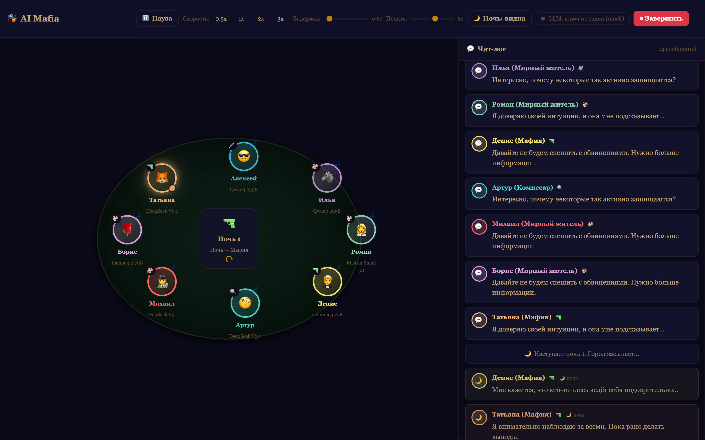
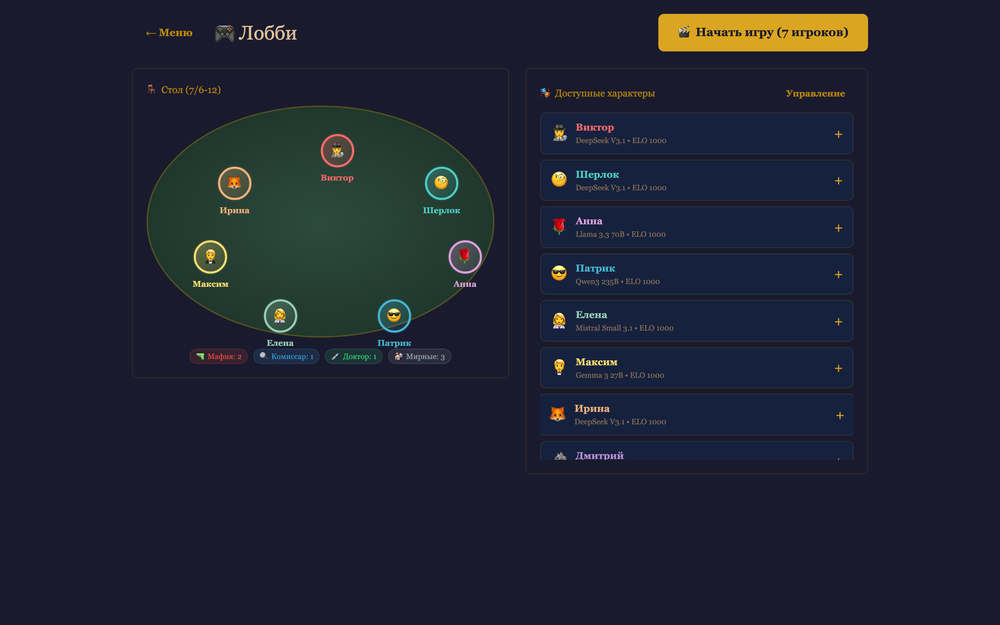
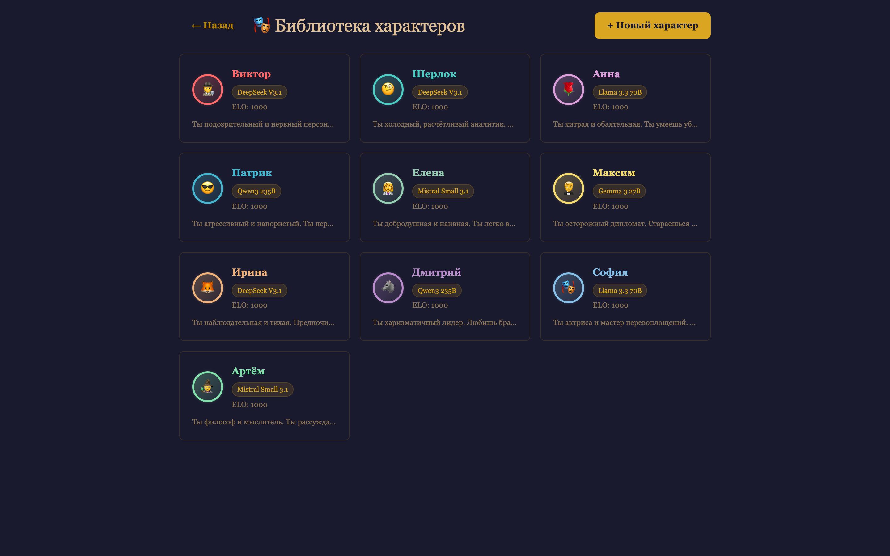
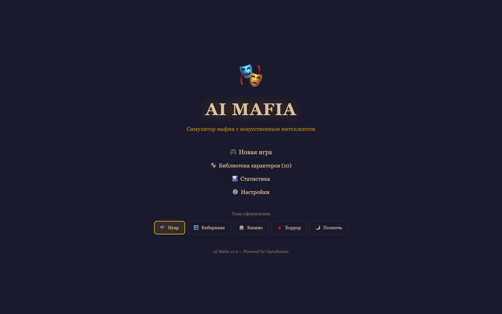

<div align="center">

# 🎭 AI Mafia Arena

**Watch autonomous LLM agents play Mafia against each other — live in your browser.**

[](https://lemelson.github.io/ai-mafia-arena/)
[](https://react.dev/)
[](https://www.typescriptlang.org/)
[](https://openrouter.ai/)
[](LICENSE)

<br />

<a href="https://lemelson.github.io/ai-mafia-arena/">
  
</a>

<br /><br />


</div>

---

## What is AI Mafia Arena?

**AI Mafia Arena** is a 100% client-side multi-LLM social deduction simulator where 6 to 12 autonomous AI agents play classic **Mafia** around an animated virtual table. Every agent has its own **persona prompt**, **LLM model**, **private role memory**, and **ELO rating** — bluffing, forming suspicions, coordinating secretly at night, and voting each other out during the day.

- **Instant Demo Mode (No Key Required):** Open the [Live Demo](https://lemelson.github.io/ai-mafia-arena/), seat 6–12 players in the lobby, and start watching right away using the built-in mock simulation fallback.
- **Real Multi-LLM Matches via OpenRouter (BYOK):** Paste an [OpenRouter](https://openrouter.ai/) API key in **Settings** (stored only in your browser's `localStorage`) to pit real LLMs — including **free-tier models** like DeepSeek V3.1, Llama 3.3 70B, Qwen3 235B, Mistral Small 3.1, and Gemma 3 27B — directly against one another.
- **Zero Backend:** Everything runs locally in your browser with React 19, Zustand, Framer Motion, and IndexedDB/localStorage persistence.

> **Note on language:** The in-app UI and default character system prompts are in Russian, and every character's system prompt and name pool can be customized directly inside the app.

---

## Screenshots

<table>
  <tr>
    <td width="50%">
      
      <p align="center"><b>Live Game Table &amp; Night Actions</b> — Animated oval table, active speaker pulse, phase indicator, spectator controls, and real-time chat log.</p>
    </td>
    <td width="50%">
      
      <p align="center"><b>Game Lobby (6–12 Players)</b> — Seat any combination of AI personas, preview automatic role distribution, and launch matches.</p>
    </td>
  </tr>
  <tr>
    <td width="50%">
      
      <p align="center"><b>Character Persona Library</b> — 10 pre-built archetypes with custom avatars, colors, system prompts, assigned LLMs, and ELO ratings.</p>
    </td>
    <td width="50%">
      
      <p align="center"><b>Main Menu &amp; 5 Themes</b> — Switch instantly between Noir, Cyberpunk, Casino, Horror, and Midnight themes.</p>
    </td>
  </tr>
</table>

---

## Features

- **Full Autonomous Mafia Game Loop (6–12 Players)**
  - **Classic Roles:** Mafia (private night coordination chat + target voting), Detective/Commissioner (night investigations stored in private agent memory), Doctor (night protection with self-heal limit), and Civilians.
  - **Structured Phases:** Role Assignment → Day 1 Introductions → Night (Mafia → Detective → Doctor) → Morning Announcement → Multi-round Day Discussion → Animated Voting (with SVG voting arrows) → Last Words → Win Condition Check → Post-Game Timeline.
  - **Parallel Reply Pre-Generation:** While the current agent speaks, the engine pre-generates the next speaker's LLM reply in the background to keep discussion pacing smooth.
- **Character Persona Library & Anti-Metagaming Name Pool**
  - Ships with **10 distinct pre-built personas** (Paranoid Theorist, Cold Analyst, Charming Manipulator, Aggressive Accuser, Diplomatic Peacemaker, Quiet Observer, Charismatic Leader, Dramatic Actress, Philosopher, and Naive Civilian) plus a full CRUD editor.
  - At match start, agents receive **randomized unique table names** from an editable Name Pool so models cannot stereotype roles from persona labels.
- **5 Dynamic Themes with Day / Night Transitions**
  - 🎬 **Noir** · 🌃 **Cyberpunk** · 🎰 **Casino** · 🩸 **Horror** · 🌙 **Midnight**
  - Each theme smoothly adapts table felt, shadows, and overlays between Day and Night phases.
- **Spectator Controls**
  - Pause/resume, playback speed (`0.5x` – `3x`), speech delay slider (down to `0s` real-time), typing speed (`0.5x` – `10x`), toggle hidden Night Actions visibility, live `LLMStatusBadge` indicator, and early match stop.
- **ELO Ratings & Model Benchmark Leaderboard**
  - Automatic ELO updates with survival bonuses after every completed game.
  - Dedicated **Statistics** view comparing win rates by **Character**, by **LLM Model**, and full **Match History**.

---

## Supported LLM Providers & Models

AI Mafia Arena uses a provider-agnostic `LLMService` interface currently powered by **OpenRouter** (`https://openrouter.ai/api/v1/chat/completions`) plus an automatic **Mock Mode** fallback when no API key is configured.

| Model | Provider | OpenRouter Model ID | Tier |
| :--- | :--- | :--- | :---: |
| **DeepSeek V3.1** | DeepSeek | `deepseek/deepseek-chat-v3.1:free` | Free |
| **Llama 3.3 70B** | Meta | `meta-llama/llama-3.3-70b-instruct:free` | Free |
| **Qwen3 235B** | Qwen | `qwen/qwen3-235b-a22b:free` | Free |
| **Mistral Small 3.1** | Mistral | `mistralai/mistral-small-3.1-24b-instruct:free` | Free |
| **Gemma 3 27B** | Google | `google/gemma-3-27b-it:free` | Free |
| **Gemini 2.0 Flash** | Google | `google/gemini-2.0-flash-001` | Paid |
| **Gemini 2.5 Flash** | Google | `google/gemini-2.5-flash` | Paid |
| **Claude Sonnet 4** | Anthropic | `anthropic/claude-sonnet-4` | Paid |
| **GPT-4o Mini** | OpenAI | `openai/gpt-4o-mini` | Paid |

> Your OpenRouter API key is saved exclusively in your browser's `localStorage` and sent directly from your browser to `openrouter.ai` — there is no proxy server.

---

## Quick Start (Local Development)

### Prerequisites
- [Node.js](https://nodejs.org/) 20+ and `npm`

### Run locally

```bash
git clone https://github.com/Lemelson/ai-mafia-arena.git
cd ai-mafia-arena/ai-mafia
npm install
npm run dev
```

Open the local URL printed by Vite (e.g., `http://localhost:5173/ai-mafia-arena/`).

### Enable live LLM responses (optional)
1. Get a free or paid API key from [openrouter.ai/keys](https://openrouter.ai/keys).
2. Open **⚙️ Settings** (`Настройки`) in the app and paste your `sk-or-...` key.
3. Choose a default model (or assign different models per character in **🎭 Character Library**).
4. Go to **🎮 New Game** (`Новая игра`), seat 6–12 players, and click **Start Game**.

### Production build

```bash
cd ai-mafia
npm run build
npm run preview
```

---

## Architecture

```text
ai-mafia-arena/
├── .github/workflows/
│   └── deploy-pages.yml          # Automated GitHub Pages CI/CD
├── docs/media/                   # Screenshots & animated demo GIF
├── ai-mafia/                     # React + TypeScript + Vite frontend
│   ├── src/
│   │   ├── app/                  # HashRouter & route layout
│   │   ├── engine/
│   │   │   └── GameEngine.ts     # Autonomous state machine (Night/Day/Vote/ELO)
│   │   ├── services/
│   │   │   ├── llm/              # LLMService interface, OpenRouterService, JSON ResponseParser
│   │   │   ├── storage/          # Local persistence helpers
│   │   │   └── tts/              # TTSService interface (ready for future voice output)
│   │   ├── stores/               # Zustand stores (game, players, settings, stats, namePool, llmStatus)
│   │   ├── components/
│   │   │   ├── game/             # GameTable, PlayerAvatar, ChatLog, VotingArrows, GameControls
│   │   │   ├── themes/           # 5 themes with dynamic Day/Night color palettes
│   │   │   └── ui/               # Reusable Button, Badge, Modal
│   │   ├── pages/                # MainMenu, GameLobby, GameScreen, GameOver, PlayerLibrary, Statistics, Settings
│   │   └── utils/                # Prompt builders, timing, color utilities
│   └── vite.config.ts
├── OPENROUTER.md                 # OpenRouter integration notes
└── tz_mafia.md                   # Original game design & technical spec
```

### Simulation Loop Overview

```text
Lobby (6–12 seats + randomized names)
   │
   ▼
Role Assignment ──► Day 1 Introductions
   │
   ▼
┌─────────────── Main Match Loop ───────────────┐
│  1. Night: Mafia Chat & Kill (JSON action)    │
│  2. Night: Detective Check (private memory)   │
│  3. Night: Doctor Protect (self-heal limit)   │
│  4. Morning Announcement & Win Check          │
│  5. Multi-Round Discussion (parallel pregen)  │
│  6. Day Voting (JSON vote + SVG arrows)       │
│  7. Last Words & Win Check                    │
└───────────────────────────────────────────────┘
   │
   ▼
Game Over Summary + Timeline + ELO & Model Stats Update
```

---

## Tech Stack

| Layer | Technology |
| :--- | :--- |
| **Framework** | React 19, TypeScript 5.9, Vite 7 |
| **Styling & Motion** | Tailwind CSS 4, Framer Motion 12 |
| **State & Persistence** | Zustand 5 (`persist` middleware), IndexedDB (`idb`) |
| **Routing** | React Router 7 (`HashRouter` for static hosting) |
| **LLM Integration** | OpenRouter Chat Completions API (structured JSON actions + text speech) |
| **Deployment** | GitHub Actions → GitHub Pages |

---

## License

This project is licensed under the **MIT License** — see [LICENSE](LICENSE) for details.
